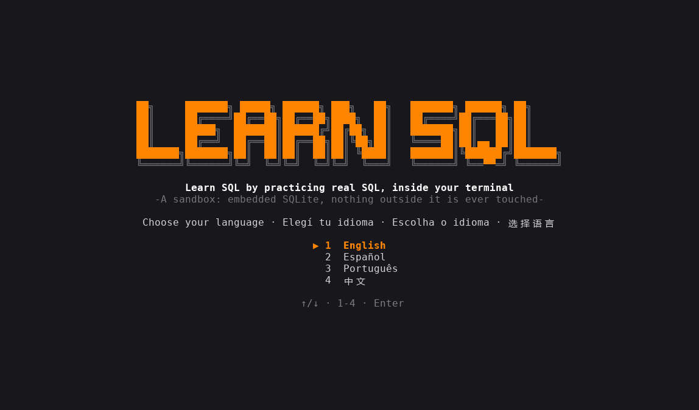

<div align="center">

**English** · [Español](docs/readme/README_es.md) · [Português (Brasil)](docs/readme/README_pt-BR.md) · [简体中文](docs/readme/README_zh.md)

# learn-sql-tui

### Learn SQL by practicing real SQL, inside your terminal.

**11 levels, 61 lessons and 90 hands-on exercises, in English, Spanish, Portuguese and Chinese. Every statement runs on a real SQLite embedded in the program, inside an isolated sandbox.**

[](#install)
[](#requirements)
[](#how-it-works)
[](#languages)

[Showcase](#showcase) · [Quick start](#quick-start) · [How it works](#how-it-works) · [Levels](#levels) · [Controls](#controls) · [FAQ](#faq) · [Development](#development)

</div>

> [!NOTE]
> Nothing to install: SQLite is compiled into the binary and the program works offline. It only reads and writes inside its own data folder.

---

Each exercise gives you a small situation and a console. You solve it however you like; pressing `F5` inspects the **state of the database** (tables, rows, indexes, pragmas), not the statements you typed, so every correct path counts. In SELECT-only exercises your last result is compared with the one of a reference query, and the order only matters when the exercise asks for an `ORDER BY`. If a check fails, the app explains what is missing and puts the sandbox back at the start of the exercise.

## Showcase

<p align="center"></p>

## Quick start

### Requirements

- Nothing at runtime: one binary for Windows or Linux, no network, no SQLite installed.
- To build from source: Rust stable with the 2024 edition (1.85 or newer) and a C compiler (SQLite is compiled from source; on Windows the MSVC build tools, on Linux `gcc` or `cc`, and `musl-tools` for the static build).

### Install

Download the binary for your system from the [Releases](https://github.com/matiasdante/learn-sql-tui/releases) page:

| System | File |
| --- | --- |
| Windows x86_64 | `learn-sql-tui-windows-x86_64.exe` |
| Linux x86_64 (static) | `learn-sql-tui-linux-x86_64` |

Or build it with cargo (this is also the way to get it on macOS):

```sh
cargo install --git https://github.com/matiasdante/learn-sql-tui
```

### Run

```sh
learn-sql-tui
learn-sql-tui --version
```

On the first launch you pick a language and can take a 10-question placement exam (two questions for each of levels 1 to 5). A perfect score starts you at level 6; skipping it starts you at level 1. Earlier levels are always open.

## How it works

- **Console.** SQL statements end with `;` and can span several lines (the prompt becomes `...>`; with an open transaction it is `sql*>`). Dot-commands work like in the `sqlite3` shell: `.tables`, `.schema`, `.indexes`, `.mode box|csv|line`, `.headers on|off`, `.read FILE`, `.import [--skip N] FILE TABLE`, `.help`, `.clear`; and `edit FILE` opens the built-in editor. Results are shown as a table (up to 200 rows).
- **Sandbox.** The practice database is `practice.db` in the sandbox folder; snapshot and restore copy the file with the connection closed. Free mode has its own `free.db`, which is kept between sessions.
- **Isolation.** An authorizer rejects `ATTACH` outside the sandbox folder and `load_extension`; `VACUUM INTO`, `.read`, `.import` and `edit` are resolved inside that folder; `SQLITE_DBCONFIG_DEFENSIVE` is on. A test checks that nothing can be written outside the sandbox.
- **Ctrl+C.** Statements run in a background thread and `Ctrl+C` interrupts them (for example an endless recursive CTE).
- **Checks.** `table_exists`, `column`, `foreign_key`, `index_exists`, `view_exists`, `trigger_exists`, `row_count`, `query_equals`, `pragma_equals`, `last_result_same_as`, `autocommit`... They run on the live session, so `PRAGMA foreign_keys` and open transactions count.
- **Foreign keys** start OFF, like in the `sqlite3` shell, because level 7 teaches how to turn them on.

## Levels

| # | Level | Lessons | Exercises |
| --- | --- | --- | --- |
| 1 | Basic queries: SELECT, WHERE, ORDER BY, LIMIT, DISTINCT, NULL, LIKE, IN/BETWEEN, CASE | 9 | 16 |
| 2 | Functions and aggregation: text/number/date, COUNT…MAX, GROUP BY, HAVING, COALESCE, CAST | 7 | 13 |
| 3 | Joins: INNER, LEFT, RIGHT/FULL, CROSS, self join, USING | 6 | 9 |
| 4 | Subqueries and sets: IN/EXISTS, correlated, UNION/INTERSECT/EXCEPT, CTE, recursive CTE | 5 | 10 |
| 5 | Changing data: INSERT, UPDATE, DELETE, UPSERT, RETURNING | 5 | 7 |
| 6 | Schema: CREATE/ALTER/DROP, types and STRICT, constraints, foreign keys, generated columns | 7 | 9 |
| 7 | Transactions and integrity: BEGIN/COMMIT/ROLLBACK, SAVEPOINT, foreign_keys, foreign_key_check | 4 | 5 |
| 8 | Views, indexes and performance: VIEW, partial and expression indexes, EXPLAIN QUERY PLAN, ANALYZE | 5 | 8 |
| 9 | Advanced SQL: window functions, triggers, JSON, FTS5 | 4 | 7 |
| 10 | Administration: ATTACH, VACUUM, integrity_check, CSV import, user_version | 5 | 6 |
| 11 | Beyond SQLite (explanations only): dialects, GRANT/REVOKE, isolation, SQL injection | 4 | 0 |

After the last practice exercise the **What now?** screen appears (and stays in the map). It recommends [lazysql](https://github.com/jorgerojas26/lazysql), a terminal UI for databases, explains how to install it and shows the path of your free-mode database so you can open it there. lazysql is only recommended; this program never launches it.

## Languages

English, Spanish (`es`), Portuguese (`pt`) and Chinese (`zh`). Press `L` in the menus to switch; the choice is saved. All texts live in `content/i18n/<language>/` and a test fails if any text is missing in any language.

## Controls

| Key | Action |
| --- | --- |
| `↑` `↓` · `Enter` · `Esc` | move, open, go back |
| `L` | change language (menus) |
| `F1` | show the next hint (−25 points) |
| `F5` | check the exercise (each failed check costs 10 points) |
| `F6` | next exercise |
| `Ctrl+R` | restart the exercise (in free mode: erase the free-mode database) |
| `Ctrl+C` | stop the running statement, or clear the line |
| `Ctrl+S` · `Esc` | in the editor: save and close · cancel |
| `Ctrl+Q` | quit |

An exercise is worth 100 points, never less than 25. There is also a **free mode** and 29 **achievements**.

## Where it stores data

Everything lives in the `learn-sql-tui` folder inside your user data directory (`~/.local/share` on Linux, `%APPDATA%` on Windows):

| Path | Content |
| --- | --- |
| `progress.json` | language, finished exercises, points, achievements |
| `sandbox/practice.db` | the database of the current exercise |
| `sandbox/work/` | files of the exercise (`.read`, `.import`, `ATTACH`) |
| `sandbox/free/free.db` | your free-mode database (open it with lazysql) |

Delete `progress.json` to start from scratch.

## FAQ

<details>
<summary><strong>Does it touch files outside its folder?</strong></summary>

No. Paths are resolved inside the sandbox, `..` is rejected, `ATTACH` and `VACUUM INTO` outside it fail, and extensions cannot be loaded.

</details>

<details>
<summary><strong>Do I have to type exactly the statements the lesson suggests?</strong></summary>

No. The checks look at the resulting state, so any correct way works. Some topics leave no state (`.tables`, `EXPLAIN`); for those the app looks at what you typed.

</details>

<details>
<summary><strong>Does it support PostgreSQL or MySQL?</strong></summary>

No, only SQLite. Level 11 explains the differences with other engines, privileges, isolation and SQL injection, without exercises.

</details>

## Development

```sh
cargo build
cargo test            # engine, isolation, Ctrl+C, every exercise against its reference solution
cargo clippy --all-targets -- -D warnings
cargo fmt --check
```

Lessons are TOML files in `content/levelNN/`, shared data scripts in `content/seeds/`, and the texts in `content/i18n/<language>/`. The content test starts every exercise, requires that the untouched state fails the checks and that the reference solution passes them.

## Releases

A tag `v*` builds the Windows `.exe` and a static Linux (musl) binary and publishes both to Releases.

```sh
git tag -a v1.0.1 -m "v1.0.1"
git push origin v1.0.1
```

## Known limits

- Other engines (PostgreSQL, MySQL), a macOS binary, mouse support and an auto-updater are out of scope. lazysql is only recommended, never launched.
- The terminal needs about 100 columns for the long screens and wide result tables. The title banner needs at least 70 columns (and a window at least 30 rows tall on the level map); otherwise it falls back to plain text.
- The orange accent is exact (#ff8400) when the terminal reports truecolor (`COLORTERM`, or Windows Terminal); otherwise it uses color 208 of the 256-color palette.
- Chinese needs a terminal font with CJK glyphs.

## License

[MIT](LICENSE). Anyone can use, copy, modify and distribute this project, for free, as long as the copyright notice is kept: **© 2026 Matias Dante Sarco**, creator of learn-sql-tui.
