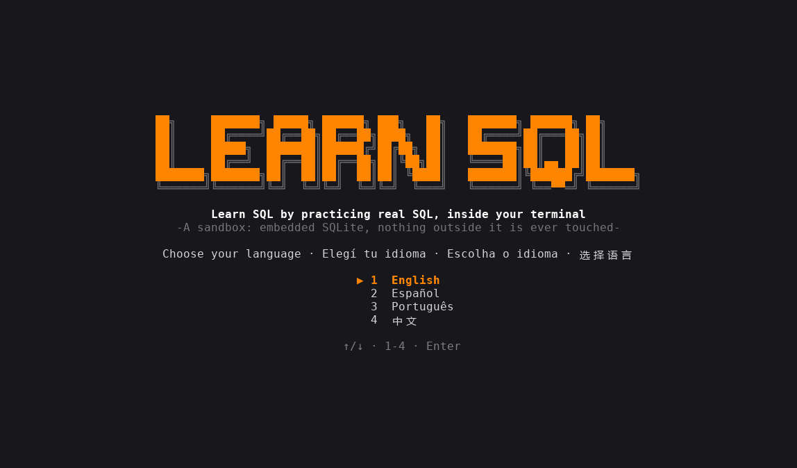

<div align="center">

[English](../../README.md) · **Español** · [Português (Brasil)](README_pt-BR.md) · [简体中文](README_zh.md)

# learn-sql-tui

### Aprendé SQL practicando con SQL real, dentro de tu terminal.

**11 niveles, 61 lecciones y 90 ejercicios prácticos, en inglés, español, portugués y chino. Cada sentencia corre sobre un SQLite real embebido en el programa, dentro de un sandbox aislado.**

[](#instalación)
[](#requisitos)
[](#cómo-funciona)
[](#idiomas)

[Demo](#demo) · [Inicio rápido](#inicio-rápido) · [Cómo funciona](#cómo-funciona) · [Niveles](#niveles) · [Controles](#controles) · [Preguntas frecuentes](#preguntas-frecuentes) · [Desarrollo](#desarrollo)

</div>

> [!NOTE]
> No hay nada que instalar: SQLite viene compilado dentro del binario y el programa funciona sin red. Solo lee y escribe dentro de su propia carpeta de datos.

---

Cada ejercicio te plantea una situación chica y una consola. Lo resolvés como quieras; al apretar `F5` se revisa el **estado de la base** (tablas, filas, índices, pragmas), no las sentencias que tipeaste, así que vale cualquier camino correcto. En los ejercicios de solo SELECT se compara tu último resultado con el de una consulta de referencia, y el orden solo cuenta cuando la consigna pide un `ORDER BY`. Si una verificación falla, la app explica qué falta y deja el sandbox como estaba al inicio del ejercicio.

## Demo

<p align="center"></p>

## Inicio rápido

### Requisitos

- Nada para ejecutarlo: un solo binario para Windows o Linux, sin red y sin SQLite instalado.
- Para compilar desde el código: Rust estable con edición 2024 (1.85 o más nuevo) y un compilador de C (SQLite se compila desde el código fuente; en Windows las build tools de MSVC, en Linux `gcc` o `cc`, y `musl-tools` para el binario estático).

### Instalación

Bajá el binario para tu sistema desde la página de [Releases](https://github.com/matiasdante/learn-sql-tui/releases):

| Sistema | Archivo |
| --- | --- |
| Windows x86_64 | `learn-sql-tui-windows-x86_64.exe` |
| Linux x86_64 (estático) | `learn-sql-tui-linux-x86_64` |

O compilalo con cargo (también es la forma de tenerlo en macOS):

```sh
cargo install --git https://github.com/matiasdante/learn-sql-tui
```

### Ejecución

```sh
learn-sql-tui
learn-sql-tui --version
```

En el primer arranque elegís idioma y podés rendir un examen de ubicación de 10 preguntas (dos por cada uno de los niveles 1 a 5). Con todo bien arrancás en el nivel 6; si lo omitís, en el nivel 1. Los niveles anteriores siempre están abiertos.

## Cómo funciona

- **Consola.** Las sentencias SQL terminan con `;` y pueden ocupar varias líneas (el prompt pasa a `...>`; con una transacción abierta es `sql*>`). Los dot-commands funcionan como en la shell de `sqlite3`: `.tables`, `.schema`, `.indexes`, `.mode box|csv|line`, `.headers on|off`, `.read ARCHIVO`, `.import [--skip N] ARCHIVO TABLA`, `.help`, `.clear`; y `edit ARCHIVO` abre el editor integrado. Los resultados se muestran en tabla (hasta 200 filas).
- **Sandbox.** La base de práctica es `practice.db` en la carpeta del sandbox; el snapshot y el restore copian el archivo con la conexión cerrada. El modo libre tiene su propio `free.db`, que se conserva entre sesiones.
- **Aislamiento.** Un authorizer rechaza `ATTACH` fuera de la carpeta del sandbox y `load_extension`; `VACUUM INTO`, `.read`, `.import` y `edit` se resuelven dentro de esa carpeta; `SQLITE_DBCONFIG_DEFENSIVE` está activado. Un test comprueba que no se puede escribir fuera del sandbox.
- **Ctrl+C.** Las sentencias corren en un hilo aparte y `Ctrl+C` las interrumpe (por ejemplo un CTE recursivo infinito).
- **Verificaciones.** `table_exists`, `column`, `foreign_key`, `index_exists`, `view_exists`, `trigger_exists`, `row_count`, `query_equals`, `pragma_equals`, `last_result_same_as`, `autocommit`... Corren sobre la sesión viva, así que cuentan `PRAGMA foreign_keys` y las transacciones abiertas.
- **Claves foráneas** arrancan en OFF, como en la shell de `sqlite3`, porque el nivel 7 enseña a activarlas.

## Niveles

| # | Nivel | Lecciones | Ejercicios |
| --- | --- | --- | --- |
| 1 | Consultas básicas: SELECT, WHERE, ORDER BY, LIMIT, DISTINCT, NULL, LIKE, IN/BETWEEN, CASE | 9 | 16 |
| 2 | Funciones y agregación: texto/número/fecha, COUNT…MAX, GROUP BY, HAVING, COALESCE, CAST | 7 | 13 |
| 3 | Joins: INNER, LEFT, RIGHT/FULL, CROSS, self join, USING | 6 | 9 |
| 4 | Subconsultas y conjuntos: IN/EXISTS, correlacionadas, UNION/INTERSECT/EXCEPT, CTE, CTE recursivo | 5 | 10 |
| 5 | Modificar datos: INSERT, UPDATE, DELETE, UPSERT, RETURNING | 5 | 7 |
| 6 | Esquema: CREATE/ALTER/DROP, tipos y STRICT, restricciones, claves foráneas, columnas generadas | 7 | 9 |
| 7 | Transacciones e integridad: BEGIN/COMMIT/ROLLBACK, SAVEPOINT, foreign_keys, foreign_key_check | 4 | 5 |
| 8 | Vistas, índices y rendimiento: VIEW, índices parciales y de expresión, EXPLAIN QUERY PLAN, ANALYZE | 5 | 8 |
| 9 | SQL avanzado: funciones de ventana, triggers, JSON, FTS5 | 4 | 7 |
| 10 | Administración: ATTACH, VACUUM, integrity_check, importar CSV, user_version | 5 | 6 |
| 11 | Más allá de SQLite (solo explicación): dialectos, GRANT/REVOKE, aislamiento, inyección SQL | 4 | 0 |

Después del último ejercicio práctico aparece la pantalla **¿Y ahora?** (y queda en el mapa). Recomienda [lazysql](https://github.com/jorgerojas26/lazysql), una interfaz de terminal para bases de datos, explica cómo instalarlo y muestra la ruta de tu base del modo libre para abrirla ahí. lazysql solo se recomienda; este programa nunca lo lanza.

## Idiomas

Inglés, español (`es`), portugués (`pt`) y chino (`zh`). Apretá `L` en los menús para cambiar; la elección se guarda. Todos los textos viven en `content/i18n/<idioma>/` y un test falla si falta algún texto en algún idioma.

## Controles

| Tecla | Acción |
| --- | --- |
| `↑` `↓` · `Enter` · `Esc` | moverse, abrir, volver |
| `L` | cambiar de idioma (menús) |
| `F1` | mostrar la siguiente pista (−25 puntos) |
| `F5` | verificar el ejercicio (cada verificación fallida cuesta 10 puntos) |
| `F6` | siguiente ejercicio |
| `Ctrl+R` | reiniciar el ejercicio (en modo libre: borrar la base del modo libre) |
| `Ctrl+C` | detener la sentencia en curso, o borrar la línea |
| `Ctrl+S` · `Esc` | en el editor: guardar y cerrar · cancelar |
| `Ctrl+Q` | salir |

Un ejercicio vale 100 puntos, nunca menos de 25. También hay un **modo libre** y 29 **logros**.

## Dónde guarda los datos

Todo vive en la carpeta `learn-sql-tui` dentro del directorio de datos de tu usuario (`~/.local/share` en Linux, `%APPDATA%` en Windows):

| Ruta | Contenido |
| --- | --- |
| `progress.json` | idioma, ejercicios terminados, puntos, logros |
| `sandbox/practice.db` | la base del ejercicio actual |
| `sandbox/work/` | archivos del ejercicio (`.read`, `.import`, `ATTACH`) |
| `sandbox/free/free.db` | tu base del modo libre (abrila con lazysql) |

Borrá `progress.json` para empezar de cero.

## Preguntas frecuentes

<details>
<summary><strong>¿Toca archivos fuera de su carpeta?</strong></summary>

No. Las rutas se resuelven dentro del sandbox, `..` se rechaza, `ATTACH` y `VACUUM INTO` hacia afuera fallan y no se pueden cargar extensiones.

</details>

<details>
<summary><strong>¿Tengo que tipear exactamente las sentencias que sugiere la lección?</strong></summary>

No. Las verificaciones miran el estado resultante, así que sirve cualquier forma correcta. Algunos temas no dejan estado (`.tables`, `EXPLAIN`); en esos la app mira lo que tipeaste.

</details>

<details>
<summary><strong>¿Soporta PostgreSQL o MySQL?</strong></summary>

No, solo SQLite. El nivel 11 explica las diferencias con otros motores, los permisos, el aislamiento y la inyección SQL, sin ejercicios.

</details>

## Desarrollo

```sh
cargo build
cargo test            # motor, aislamiento, Ctrl+C, cada ejercicio contra su solución de referencia
cargo clippy --all-targets -- -D warnings
cargo fmt --check
```

Las lecciones son archivos TOML en `content/levelNN/`, los scripts de datos compartidos están en `content/seeds/` y los textos en `content/i18n/<idioma>/`. El test de contenido arranca cada ejercicio, exige que el estado sin tocar falle las verificaciones y que la solución de referencia las pase.

## Releases

Un tag `v*` compila el `.exe` de Windows y un binario estático de Linux (musl) y publica los dos en Releases.

```sh
git tag -a v1.0.1 -m "v1.0.1"
git push origin v1.0.1
```

## Límites conocidos

- Fuera de alcance: otros motores (PostgreSQL, MySQL), un binario para macOS, mouse y actualizador automático. lazysql solo se recomienda; nunca se lanza.
- La terminal necesita unas 100 columnas para las pantallas largas y las tablas de resultados anchas. El banner del título necesita al menos 70 columnas (y una ventana de al menos 30 filas en el mapa de niveles); si no entra, se muestra texto simple.
- El naranja de acento es exacto (#ff8400) cuando la terminal informa truecolor (`COLORTERM`, o Windows Terminal); si no, usa el color 208 de la paleta de 256 colores.
- El chino necesita una tipografía de terminal con caracteres CJK.

## Licencia

[MIT](../../LICENSE). Cualquiera puede usar, copiar, modificar y distribuir este proyecto, gratis, siempre que conserve el aviso de copyright: **© 2026 Matias Dante Sarco**, creador de learn-sql-tui.
