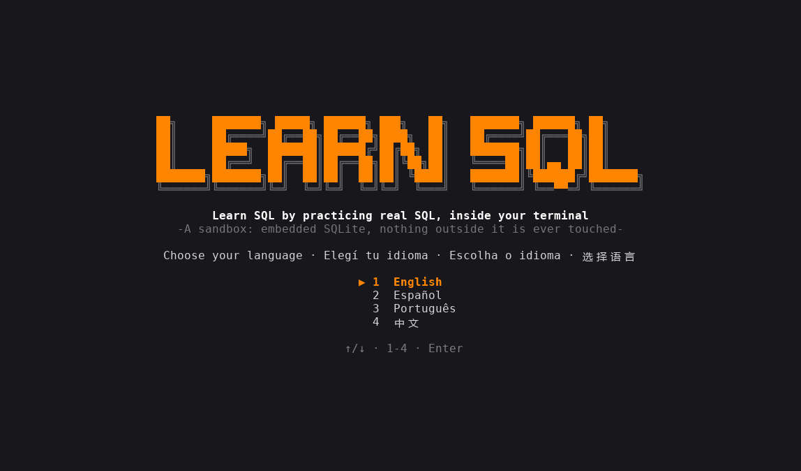

<div align="center">

[English](../../README.md) · [Español](README_es.md) · **Português (Brasil)** · [简体中文](README_zh.md)

# learn-sql-tui

### Aprenda SQL praticando com SQL de verdade, dentro do seu terminal.

**11 níveis, 61 lições e 90 exercícios práticos, em inglês, espanhol, português e chinês. Cada instrução roda em um SQLite real embutido no programa, dentro de um sandbox isolado.**

[](#instalação)
[](#requisitos)
[](#como-funciona)
[](#idiomas)

[Demonstração](#demonstração) · [Início rápido](#início-rápido) · [Como funciona](#como-funciona) · [Níveis](#níveis) · [Controles](#controles) · [Perguntas frequentes](#perguntas-frequentes) · [Desenvolvimento](#desenvolvimento)

</div>

> [!NOTE]
> Não há nada para instalar: o SQLite vem compilado dentro do binário e o programa funciona sem rede. Ele só lê e escreve dentro da sua própria pasta de dados.

---

Cada exercício apresenta uma situação pequena e um console. Você resolve como quiser; ao apertar `F5` o app inspeciona o **estado do banco** (tabelas, linhas, índices, pragmas), não as instruções que você digitou, então qualquer caminho correto vale. Nos exercícios só de SELECT, seu último resultado é comparado com o de uma consulta de referência, e a ordem só conta quando o exercício pede um `ORDER BY`. Se uma verificação falha, o app explica o que falta e devolve o sandbox ao início do exercício.

## Demonstração

<p align="center"></p>

## Início rápido

### Requisitos

- Nada para executar: um único binário para Windows ou Linux, sem rede e sem SQLite instalado.
- Para compilar a partir do código: Rust estável com a edição 2024 (1.85 ou mais novo) e um compilador C (o SQLite é compilado a partir do código-fonte; no Windows as build tools do MSVC, no Linux `gcc` ou `cc`, e `musl-tools` para o binário estático).

### Instalação

Baixe o binário para o seu sistema na página de [Releases](https://github.com/matiasdante/learn-sql-tui/releases):

| Sistema | Arquivo |
| --- | --- |
| Windows x86_64 | `learn-sql-tui-windows-x86_64.exe` |
| Linux x86_64 (estático) | `learn-sql-tui-linux-x86_64` |

Ou compile com o cargo (também é o jeito de tê-lo no macOS):

```sh
cargo install --git https://github.com/matiasdante/learn-sql-tui
```

### Execução

```sh
learn-sql-tui
learn-sql-tui --version
```

Na primeira execução você escolhe o idioma e pode fazer um exame de nivelamento de 10 perguntas (duas para cada um dos níveis 1 a 5). Com tudo certo você começa no nível 6; se pular, começa no nível 1. Os níveis anteriores ficam sempre abertos.

## Como funciona

- **Console.** As instruções SQL terminam com `;` e podem ocupar várias linhas (o prompt vira `...>`; com uma transação aberta é `sql*>`). Os dot-commands funcionam como no shell do `sqlite3`: `.tables`, `.schema`, `.indexes`, `.mode box|csv|line`, `.headers on|off`, `.read ARQUIVO`, `.import [--skip N] ARQUIVO TABELA`, `.help`, `.clear`; e `edit ARQUIVO` abre o editor integrado. Os resultados aparecem em tabela (até 200 linhas).
- **Sandbox.** O banco de prática é `practice.db` na pasta do sandbox; o snapshot e o restore copiam o arquivo com a conexão fechada. O modo livre tem seu próprio `free.db`, que é mantido entre sessões.
- **Isolamento.** Um authorizer rejeita `ATTACH` fora da pasta do sandbox e `load_extension`; `VACUUM INTO`, `.read`, `.import` e `edit` são resolvidos dentro dessa pasta; `SQLITE_DBCONFIG_DEFENSIVE` está ativado. Um teste verifica que nada pode ser escrito fora do sandbox.
- **Ctrl+C.** As instruções rodam em uma thread separada e `Ctrl+C` as interrompe (por exemplo uma CTE recursiva infinita).
- **Verificações.** `table_exists`, `column`, `foreign_key`, `index_exists`, `view_exists`, `trigger_exists`, `row_count`, `query_equals`, `pragma_equals`, `last_result_same_as`, `autocommit`... Rodam na sessão viva, então contam `PRAGMA foreign_keys` e transações abertas.
- **Chaves estrangeiras** começam em OFF, como no shell do `sqlite3`, porque o nível 7 ensina a ativá-las.

## Níveis

| # | Nível | Lições | Exercícios |
| --- | --- | --- | --- |
| 1 | Consultas básicas: SELECT, WHERE, ORDER BY, LIMIT, DISTINCT, NULL, LIKE, IN/BETWEEN, CASE | 9 | 16 |
| 2 | Funções e agregação: texto/número/data, COUNT…MAX, GROUP BY, HAVING, COALESCE, CAST | 7 | 13 |
| 3 | Junções (joins): INNER, LEFT, RIGHT/FULL, CROSS, self join, USING | 6 | 9 |
| 4 | Subconsultas e conjuntos: IN/EXISTS, correlacionadas, UNION/INTERSECT/EXCEPT, CTE, CTE recursiva | 5 | 10 |
| 5 | Modificar dados: INSERT, UPDATE, DELETE, UPSERT, RETURNING | 5 | 7 |
| 6 | Esquema: CREATE/ALTER/DROP, tipos e STRICT, restrições, chaves estrangeiras, colunas geradas | 7 | 9 |
| 7 | Transações e integridade: BEGIN/COMMIT/ROLLBACK, SAVEPOINT, foreign_keys, foreign_key_check | 4 | 5 |
| 8 | Views, índices e desempenho: VIEW, índices parciais e de expressão, EXPLAIN QUERY PLAN, ANALYZE | 5 | 8 |
| 9 | SQL avançado: funções de janela, triggers, JSON, FTS5 | 4 | 7 |
| 10 | Administração: ATTACH, VACUUM, integrity_check, importar CSV, user_version | 5 | 6 |
| 11 | Além do SQLite (somente explicação): dialetos, GRANT/REVOKE, isolamento, injeção de SQL | 4 | 0 |

Depois do último exercício prático aparece a tela **E agora?** (e ela fica no mapa). Ela recomenda o [lazysql](https://github.com/jorgerojas26/lazysql), uma interface de terminal para bancos de dados, explica como instalá-lo e mostra o caminho do seu banco do modo livre para abri-lo lá. O lazysql só é recomendado; este programa nunca o executa.

## Idiomas

Inglês, espanhol (`es`), português (`pt`) e chinês (`zh`). Aperte `L` nos menus para trocar; a escolha é salva. Todos os textos ficam em `content/i18n/<idioma>/` e um teste falha se faltar algum texto em algum idioma.

## Controles

| Tecla | Ação |
| --- | --- |
| `↑` `↓` · `Enter` · `Esc` | mover, abrir, voltar |
| `L` | trocar de idioma (menus) |
| `F1` | mostrar a próxima dica (−25 pontos) |
| `F5` | verificar o exercício (cada verificação falha custa 10 pontos) |
| `F6` | próximo exercício |
| `Ctrl+R` | reiniciar o exercício (no modo livre: apagar o banco do modo livre) |
| `Ctrl+C` | parar a instrução em andamento, ou limpar a linha |
| `Ctrl+S` · `Esc` | no editor: salvar e fechar · cancelar |
| `Ctrl+Q` | sair |

Um exercício vale 100 pontos, nunca menos de 25. Também há um **modo livre** e 29 **conquistas**.

## Onde guarda os dados

Tudo fica na pasta `learn-sql-tui` dentro do diretório de dados do seu usuário (`~/.local/share` no Linux, `%APPDATA%` no Windows):

| Caminho | Conteúdo |
| --- | --- |
| `progress.json` | idioma, exercícios concluídos, pontos, conquistas |
| `sandbox/practice.db` | o banco do exercício atual |
| `sandbox/work/` | arquivos do exercício (`.read`, `.import`, `ATTACH`) |
| `sandbox/free/free.db` | seu banco do modo livre (abra-o com o lazysql) |

Apague `progress.json` para recomeçar do zero.

## Perguntas frequentes

<details>
<summary><strong>Ele mexe em arquivos fora da própria pasta?</strong></summary>

Não. Os caminhos são resolvidos dentro do sandbox, `..` é rejeitado, `ATTACH` e `VACUUM INTO` para fora falham e extensões não podem ser carregadas.

</details>

<details>
<summary><strong>Preciso digitar exatamente as instruções que a lição sugere?</strong></summary>

Não. As verificações olham o estado resultante, então qualquer forma correta serve. Alguns temas não deixam estado (`.tables`, `EXPLAIN`); nesses o app olha o que você digitou.

</details>

<details>
<summary><strong>Suporta PostgreSQL ou MySQL?</strong></summary>

Não, só SQLite. O nível 11 explica as diferenças para outros motores, permissões, isolamento e injeção de SQL, sem exercícios.

</details>

## Desenvolvimento

```sh
cargo build
cargo test            # motor, isolamento, Ctrl+C, cada exercício contra sua solução de referência
cargo clippy --all-targets -- -D warnings
cargo fmt --check
```

As lições são arquivos TOML em `content/levelNN/`, os scripts de dados compartilhados ficam em `content/seeds/` e os textos em `content/i18n/<idioma>/`. O teste de conteúdo inicia cada exercício, exige que o estado intocado falhe nas verificações e que a solução de referência passe.

## Releases

Uma tag `v*` compila o `.exe` do Windows e um binário estático do Linux (musl) e publica os dois em Releases.

```sh
git tag -a v1.0.1 -m "v1.0.1"
git push origin v1.0.1
```

## Limites conhecidos

- Fora do escopo: outros motores (PostgreSQL, MySQL), um binário para macOS, mouse e atualizador automático. O lazysql só é recomendado; nunca é executado.
- O terminal precisa de umas 100 colunas para as telas longas e as tabelas de resultado largas. O banner do título precisa de pelo menos 70 colunas (e uma janela de pelo menos 30 linhas no mapa de níveis); se não couber, aparece texto simples.
- O laranja de destaque é exato (#ff8400) quando o terminal informa truecolor (`COLORTERM`, ou o Windows Terminal); caso contrário, usa a cor 208 da paleta de 256 cores.
- O chinês precisa de uma fonte de terminal com caracteres CJK.

## Licença

[MIT](../../LICENSE). Qualquer pessoa pode usar, copiar, modificar e distribuir este projeto, de graça, desde que mantenha o aviso de copyright: **© 2026 Matias Dante Sarco**, criador do learn-sql-tui.
